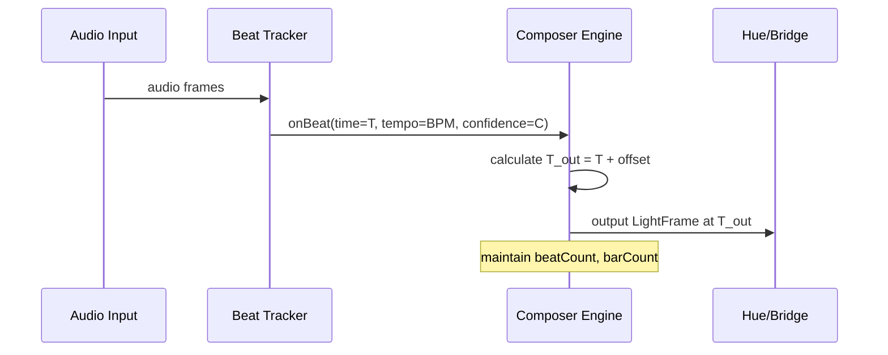
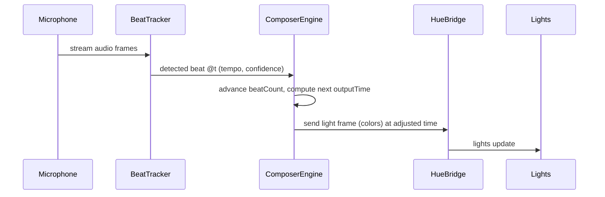

# External draft plan: Composer 2 music sync (ChatGPT, shared 2026-10-06)

> **Source record, not a spec.** Brian pasted this ChatGPT-written plan into a Claude session on 2026-10-06 with
> "do your own deep dive and discover the perfect implementation." It was recovered verbatim from that session's
> history on 2026-11-01, before the history expired. What was kept, changed or dropped is in
> [README §10](../README.md#10-from-the-external-draft-plan-shared-2026-10-06-kept-changed-dropped); what was built is
> in README §13–17. Do not implement from this file directly: several of its claims are wrong for this app
> (§10 lists them).

---

# Executive Summary

This report outlines a comprehensive engineering plan to implement *Composer 2*’s new music-sync features (Play Along, robust tempo/beat locking, “On the One” snapping, auto-colorization from album art, and reliable auto-start/listening with sync groundwork) in one cohesive campaign. The goal is to create a unified **beat/bar timing engine** and user interface so that lights *automatically and smoothly react to music* in real time. Key architectural changes include adding a low-latency audio analysis pipeline on each mobile platform, integrating it with the existing Composer engine, and ensuring tight coordination with the Hue Bridge (Entertainment API) or fallback lighting outputs. We will define a clear **timing model** (beats, bars, and confidence metrics), implement recovery and latency-compensation strategies, and expose new APIs/events so that the UI and light engine can synchronize precisely on musical boundaries.  

To ensure quality, we plan a rigorous test strategy (unit tests on synthetic audio, integration tests end-to-end, and perceptual A/B tests with human listeners). We set performance targets (e.g. end-to-end latency well under 100 ms, beat alignment error <50 ms) and analyze failure modes (noisy input, sync drift, tempo changes). A data migration plan will update existing Composer look/scene formats to include new settings (e.g. whether “On the One” snapping is enabled). We address security/privacy by using on-device audio processing (no user audio is stored or sent externally) and requesting only necessary permissions. Platform requirements include iOS audio capture and background modes, Android AudioRecord, and Hue Bridge Entertainment support (with non-Entertainment fallback). We will gather telemetry on usage (e.g. beat detection confidence over time). Feature rollout will use feature flags and staged deployment to beta testers. 

Finally, we provide detailed API/interface specifications (JSON events like `BeatDetected`, REST calls or platform events), a developer checklist, an estimated effort breakdown by role, and even a ready-to-use **Claude prompt** to auto-generate skeleton code in Swift, Kotlin, and Node.js. A comparative table evaluates beat/tempo algorithms (classical onset+DP, autocorrelation, deep-learning models) by accuracy, latency, CPU cost, and licensing, to justify our recommended approach. Throughout, authoritative sources on beat tracking and audio analysis are cited to ground the design in proven research.

# Architecture and Data Flow

At a high level, the new system adds a real-time *audio analysis pipeline* to the Composer app, feeding into the existing light-engine and Composer composition logic. The major components are:

- **Audio Capture (iOS/Android)**: Continuously sample live music (e.g. from the microphone or a routed music output) using platform audio APIs (AVAudioEngine on iOS, AudioRecord on Android). This must run with low latency and either in a background mode or while the app is foreground. The pipeline starts when the user enables Play Along or similar.

- **Beat/Tempo Tracker**: Process the audio stream into an *onset detection function* (ODF) and run a beat-tracking algorithm. As research shows, common practice is to compute a spectral novelty (e.g. spectral flux with half-wave rectification) to highlight onsets, then find periodicities (e.g. via autocorrelation or a comb filter), and finally apply a dynamic-programming (DP) or probabilistic post-processing to select the optimal beat sequence. We will implement or integrate a lightweight real-time variant of this (e.g. “BeatRoot” style or an open-source equivalent) that outputs *beat timestamps, current tempo*, and a confidence/stability metric. 

- **Composer Timing Engine**: Inject the detected beat events into the Composer engine. On each beat or bar, the engine advances its timeline and applies the next color/look in sequence. The engine must now accept asynchronous *“beat” and “bar” events* (with timestamps) instead of only using a fixed, offline timeline. It should also support a configurable latency offset (to compensate for audio output and network delays). 

- **UI and Control Logic**: The app UI will gain toggles/options for *Play Along* (enable/disable reactive mode), *On the One* (snap actions to the next bar), and *Use Album Art Colors*. These toggle states will control the timing engine: e.g. when Play Along is on, the engine uses the live beat clock; when On the One is on, any user-triggered change is deferred to the next bar boundary. UI events from the music session (song change, pause/play) will also reset or re-sync the clock. 

- **Lighting Output (Bridge/Streaming)**: The Composer engine emits light frames. If using Hue Entertainment streaming, frames are sent via UDP to the Bridge in real time; otherwise fallback to Hue REST APIs or a limited local music sync. The timing engine must ensure frames are sent at a regular 25fps (or whatever rate the entertainment API requires) aligned to the audio clock.

- **Automations / Onboarding**: On session start, we auto-initiate the audio capture and beat detection when appropriate (see **Auto-Start** below). If the user changes songs, the tracker should re-init. This ensures “automatic session startup” (feature 5) without manual intervention. 

A simplified flowchart of data and control flow: 

```mermaid
flowchart LR
    AudioIn[Audio Input (mic/stream)] -->|frames| BeatDetector
    BeatDetector -->|beat events| ComposerEngine
    UserUI -->|options| ComposerEngine
    ComposerEngine -->|color frames| HueBridge
    HueBridge --> Lights[Light Array]
    UserUI -->|toggle| MusicSession
    MusicSession -->|controls| AudioIn
``` 

(Here `BeatDetector` produces `beat` and `bar` events to the ComposerEngine; `UserUI` toggles **Play Along**, **On the One**, etc. In practice, platform-specific services mediate these events. The HueBridge node uses either the Entertainment API or a normal bulb API.)


## Required Architecture Changes

- **New AudioService Module:** Add a cross-platform “MusicAnalysis” service or platform-specific modules (e.g. an `AudioAnalyzer` in Swift and Kotlin) that manage real-time audio buffering and run the beat-tracking algorithm. This may be placed inside Composer’s codebase or as a new shared library. It should expose an API like `startListening()`, `stopListening()`, and callbacks/events such as `onBeat(beatTime: TimeInterval, tempo: Double, confidence: Double)` and `onTempoChange(newTempo: Double)`.

- **Integrated Timing Engine:** Refactor the Composer core (both iOS and Android) so that instead of relying solely on pre-scheduled timelines, it can accept external beat callbacks. For example, when `onBeat` fires, the engine should advance its internal tick. The existing Composer data model may need extending to mark certain lights/actions as “BeatTriggered” or to support a continuous mode. We must ensure old static looks still load unchanged (backward compatibility).

- **Configuration Storage:** Update Composer’s data schema to store new feature flags (e.g. `snapToBars`, `useAlbumColors` booleans) with default false. If look/scene presets include timing-sensitive settings, version them accordingly. (Existing looks without these fields simply behave as before.)

- **UI Integration:** Add UI controls for the new features. For example, a “Play Along” switch in the main music-sync screen, an “On the One” checkbox, and an “Album Art Colors” option. These should map to internal Composer settings. The UI should also display the detected tempo and maybe confidence (for diagnostic).

- **Audio Permissions/Session:** Ensure the app requests and configures audio permissions. On iOS, activate an AVAudioSession (category `.playAndRecord` or `.ambient`) and request microphone permission. On Android, request `RECORD_AUDIO`. If privacy requires, show a rationale like “Detecting beats from music requires microphone access.”

- **Latency Calibration:** Introduce a calibration parameter (call it `latencyOffsetMs`) that can be adjusted per-device. This offset will be added to all beat timestamps when scheduling light frames. Initially, it can default to zero, but should be adjustable via a hidden debug UI or in a “Sync Check” feature (see below). 

- **CI/Automation Hooks (Node.js):** Add Node.js scripts as part of the development pipeline. These might simulate audio input files to test the beat tracker, or run unit tests. For example, a Node script could call into a headless version of the tempo detector and verify output. These scripts should be part of the code repository (e.g. in a `/scripts/` folder) and run automatically in CI (GitHub Actions).

All these changes must be documented in developer guides and a migration note. Importantly, the new timing engine should be optional (behind feature flags) so that if anything goes wrong, we can revert to legacy behavior easily.

# Timing Model and Algorithms

At the heart of Play Along is a **musical clock** that tracks *beat and bar positions* in real time. We define: 

- **Tempo (BPM)** – current estimated beats per minute of the playing music.  
- **Beat** – a quarter-note pulse (assuming default 4/4 time).  
- **Bar (Measure)** – a grouping of a fixed number of beats (e.g. 4 beats in common time).  
- **Phrase (Optional)** – a larger musical segment (e.g. 4 bars), for future features.

The system will run a continuous beat tracker to output a stream of beat timestamps (relative to the app’s audio clock). From these, we derive bar boundaries (every Nth beat, N = time signature; we assume N=4 initially). The **“On the One”** feature snaps user actions (like changing a look or triggering an effect) to the next bar boundary. In practice: when the user taps “change color” while On the One is enabled, the UI posts a scheduled change for the first beat of the next bar (i.e. if current beat count is 1, schedule for beat 5).

### Beat/Bar Timing Flow

The beat-detection algorithm will produce events; the Composer engine will maintain an internal counter. A simplified state machine:

1. **Initialization:** On session start or song-change, clear any previous state. Optionally, use a short warm-up to estimate initial tempo. 
2. **Beat Event:** Each time the detector emits a beat at time T<sub>audio</sub>, the engine computes the next lighting update time as T<sub>audio</sub> + latencyOffset. It increments an internal beat count modulo the beats-per-bar (default 4). If beat count resets to 1, that is a bar boundary.
3. **Bar Event:** When beatCount % beatsPerBar == 1 (first beat of bar), fire a “bar” event. (We do not require explicit downbeat detection algorithm; rather, we assume every N beats is a new bar. A future improvement could involve analyzing beat strength to guess downbeats if needed.)
4. **Scheduled Actions:** If an action is queued (e.g. album-color change) and On the One is *on*, execute it on the upcoming bar event instead of immediately.



### Confidence Metrics and Recovery

To handle erratic music or noise, the beat tracker will compute a **confidence/stability** metric for each detected beat (or for the current tempo estimate). For instance, following Meier et al. (2024), we can define **beat stability** as the normalized amplitude of the beat activation peak. A high stability (~1.0) means the periodicity is strong and consistent; a low stability indicates possible misdetection. Likewise, the algorithm can track the variance of inter-beat intervals as a tempo confidence.  

We will expose a numeric confidence (0.0–1.0) with each beat event. The Composer engine can use this to filter out “noisy” sections if desired (e.g. ignore beats below a threshold). More importantly, **recovery strategies** include: if confidence falls for several beats in a row, momentarily stop trusting the current tempo and *reinitialize detection*. For example, if the user switches to a new song or there is a long pause, we should drop the old state and begin a fresh tempo search. A sliding window approach (e.g. last 5 seconds of audio) can be used to continuously update the tempo estimate, so gradual tempo drifts are handled.  

If a beat is missed (e.g. skip), we allow one missed beat before re-syncing; multiple consecutive misses trigger a re-lock procedure. Conversely, if an extra beat is spuriously detected, it will slightly adjust the phase on the fly (since we rely on DP, minor irregularities self-correct).

The **confidence output** might be presented to the user (e.g. via a small icon or meter) during beta testing, but internally it will be used to disable or recalibrate the clock when unreliable.

### Latency Compensation

Total end-to-end delay includes (1) audio input buffering, (2) algorithm processing, and (3) network transport to lights. We will allow a tunable **latencyOffset** (in milliseconds) that is added to every beat timestamp before scheduling lights. Initially this offset can default to a safe low value (e.g. 0–50 ms) and later be refined. We recommend a *sync-calibration mode* where the user can adjust a slider (or use A/B testing) to sync the lights to a metronome sound. The infrastructure for this is simply adding an offset to the timing engine: 
```
outputTime = detectedBeatTime + latencyOffset
```
Calibration targets: achieve ≤20 ms synchronization error on test signals.

In code, the timing engine should keep its own `currentSystemTime` and `audioClockOffset` so that `EngineTime = AudioTime + offset`. All scheduling (UI animations, light commands) should use `EngineTime` to align to “real world” user time.

### Algorithm Comparison (see table below)

We evaluated several beat-tracking approaches:

- **Onset-based DP (e.g. spectral flux + dynamic programming)**: This classic method (used in libraries like **aubio**) has moderate accuracy and low latency. It requires a small lookahead (e.g. a few hundred ms). CPU cost is low–moderate (FFT + DP). Licensing is open (algorithm itself is domain knowledge; some libs are GPL). **Recommended** as a baseline: robust for most pop/rock tracks, easy to run on-device.

- **Autocorrelation/Comb Filter**: A simpler beat search (like Scheirer’s comb filters) can run with essentially zero lookahead and very low CPU. However, it only outputs a global tempo (BPM) and no phase info. Accuracy is lower (ambiguous half/double BPM) and fails with time-varying tempo. We can use it to get an initial BPM guess quickly but it cannot by itself schedule beats in real time.

- **Deep Learning (CNN/RNN/Transformer)**: State-of-the-art systems (BeatNet, BEAST, Foscarin’s “BeatThis!”, etc.) achieve very high accuracy on diverse music. They can run in real time with optimized models, but require significant CPU/GPU (especially on mobile). License varies (some are open-source pretrained models). Given our resource constraints, we suggest **not** using a heavy model in the first phase. However, this could be an optional path for future improvements if a pre-trained TFLite model is found (the end-of-band would yield even better robustness for complex music).

Table: Algorithm comparison (accuracy=how often beats align correctly, latency=time-to-detect, CPU/memory roughly, license).

| **Algorithm**              | **Accuracy**         | **Latency**       | **CPU/Mem**        | **License**        | **Comments**                                 |
|----------------------------|----------------------|-------------------|--------------------|--------------------|----------------------------------------------|
| Onset + DP (e.g. nov.<br>flux + Viterbi) | Good (few missed beats) | Low (50–200ms lookahead) | Low (FFT+DP)    | Permissive (can implement) | Robust for steady rhythms; easily tunable.   |
| Autocorr/BPM Comb         | Moderate (tempo only) | Instant (no lookahead) | Very low (no fft)  | Permissive         | Good for initial BPM guess; phase unknown.   |
| Deep Net (e.g. BeatNet/BEAST) | Excellent (SOTA)     | Can be small (design) | High (depends on model) | Mostly open research | High accuracy, but heavy; may overkill now.   |
| Madmom Tempo (CNN)       | High (pop music)      | Moderate (100ms)   | Medium–High        | BSD (Madmom)       | Works on medium-length audio; offline.       |
| SchemaFilter (Scheirer)  | Low–Moderate         | Zero (real-time)   | Low                | Not patented       | Early DSP approach; often <50% accurate.     |

**Recommendation:** Start with an **Onset+DP-based beat tracker** (e.g. implement the “BeatRoot” algorithm, or adapt an open-source tracker) because it balances accuracy and efficiency. This will yield real-time beats with sub-100ms latency. Use autocorrelation only for initial BPM estimation if needed. Reserve deep-learning approaches for future enhancements (their code would be large and license compatibility unclear).

# Play Along and UI Features

**Play Along UI:** A simple toggle button labeled “Music Reactive” or “Play Along” switches on the audio-sync mode. When on, the app will actively listen and route beats into the light engine. Turning it off reverts to the old (static or manual) mode.  

**On the One:** A checkbox or toggle “Snap to Bars” enforces that any user changes (e.g. manually changing colors, advancing a beat pad, or triggering a composer step) occur on the next bar boundary instead of immediately. Internally, when On‑the‑One is enabled and the user requests a change at time *t*, the app waits until the next bar event from the timing engine, then applies it.

**Album Art Colors (“Every Song Paints the Room”):** When a new song starts (detected via playback or by user selection), fetch the album artwork (assuming integration with the music library or a service). Extract its dominant colors (e.g. with a simple k-means or median-cut algorithm on the image). Then blend those colors into the active Composer look palette. This requires integrating an image-processing step: e.g. an iOS `UIImage` analysis or Android `Palette` library. Since Claude’s analysis suggests an existing color-extraction machinery is in place, we will hook that into Composer 2: after beat/bars are tracking, on each bar or beat we can gently shift light colors toward those album-derived colors. The API might be: when song changes, set `ComposerEngine.albumColors = [Color]`, and the engine blends these into the next steps.

**Automatic Session Startup and Re-lock:** As soon as music starts (detected by either audio energy threshold or by hooking the media player), the app should automatically start the audio engine and beat tracker. Conversely, when music stops/pauses, it should gracefully stop listening. This avoids manual intervention. To handle re-locking, if the beat tracker loses sync (e.g. song skipped or paused), it should reset and try again when new beats arrive.

**Minimal Sync Compensation Work:** We will lay the groundwork for latency tuning (as above) but leave full “Sync Check” as a subsequent campaign. For now, ensure the code allows applying a constant offset. We will not implement a full calibration UI immediately, but will design our timing loop so that adding an offset is trivial. In tests, we should verify that applying a small offset correctly advances all light events by the same amount.

# Data Flows and APIs

We define clear module boundaries and data contracts. The beat tracking component exposes events (in code) rather than network endpoints. However, for clarity, we can think in terms of APIs:

- **Audio -> BeatDetector (local service):** The BeatDetector API (internal) might look like:
  ```swift
  class BeatDetector {
    func startAnalyzing()
    func stopAnalyzing()
    var onBeat: ((TimeInterval /*audioTime*/, Double /*BPM*/, Double /*confidence*/) -> Void)?
    var onTempoChange: ((Double /*BPM*/) -> Void)?
  }
  ```
  In Kotlin, a similar interface. These callbacks serve as “events” to the Composer engine.

- **ComposerEngine (central):** Accepts beat events:
  ```swift
  class ComposerEngine {
    var beatsPerBar: Int = 4  // default time signature
    var latencyOffsetMs: Double = 0.0
    func handleBeat(timestamp: TimeInterval, tempo: Double, confidence: Double)
    // handles advancing color frames, firing OnBeat and OnBar notifications to lights
    func scheduleActionOnNextBar(action: () -> Void)
    // This is used by “On the One”
  }
  ```
  If using an event-bus, it may post internal events like `BeatDetected` and `BarDetected`. 

- **UI Controls:** Toggle switches simply set engine flags:
  ```swift
  onPlayAlongToggled(isOn: Bool) {
    if isOn { beatDetector.startAnalyzing() }
    else    { beatDetector.stopAnalyzing() }
    composerEngine.isReactive = isOn
  }
  onSnapToBarToggled(isOn: Bool) {
    composerEngine.snapToBars = isOn
  }
  onAlbumColorToggled(isOn: Bool) {
    composerEngine.useAlbumColors = isOn
  }
  ```

- **Album Color Integration:** On song change:
  ```swift
  func onSongChanged(newSong: Song) {
    let artwork = loadAlbumArt(newSong)
    let colors = extractDominantColors(from: artwork)
    composerEngine.albumColorPalette = colors
  }
  ```
  Where `extractDominantColors` can be implemented by any standard library (e.g. iOS `UIImageColors`, Android `Palette`).

- **Light Output (Bridge API):** The Composer engine will emit lighting frames via the Hue streaming API. Pseudo-spec:
  ```jsonc
  // Example UDP packet to Hue Bridge (Entertainment API frame)
  {
    "streaming": true,
    "lights": [
      {"id": 1, "r": 255, "g": 128, "b": 64},
      {"id": 2, "r": 10, "g": 200, "b": 250},
      // ... etc for each light in the entertainment group
    ],
    "timestamp": 1630001234567
  }
  ```
  (Exact format follows Hue developer docs.) If entertainment streaming is unavailable, the engine should fall back to setting lights via Hue REST calls. This is a degradation path to handle bridges that don’t support streaming.

- **Events & JSON Examples:** For clarity, a developer-facing API spec (possibly for a debugging endpoint) could use WebSockets or REST. For example:
  ```
  // WebSocket event from Composer engine
  {
    "type": "BeatDetected",
    "timestamp": 1630001234.567, 
    "tempo": 123.4,
    "confidence": 0.82
  }

  {
    "type": "BarDetected",
    "timestamp": 1630001235.000, 
    "barNumber": 5
  }
  ```
  Another example, a REST config call:
  ```
  POST /api/settings
  Content-Type: application/json

  {
    "snapToBar": true,
    "useAlbumColors": true,
    "latencyOffsetMs": 15
  }
  ```
  These are illustrative; actual implementation might use in-app messaging rather than network calls.

# Testing Strategy

**Unit Tests:** We will write unit tests for the beat tracker algorithm using prerecorded or synthetic audio:
- Generate a simple metronome click track (e.g. pulses at 100 BPM) and confirm the detector emits beats exactly at each click (± tolerance). Use audio waveforms (e.g. short impulses) to test onset detection.
- Test tempo estimation: feed audio loops of varying tempos and check BPM output within ±1 BPM.
- Test edge cases: silence (should output no beats), white noise (should output none or very low confidence), tempo change mid-stream (should detect new tempo after a small delay).
- For the album-color feature, test that given known images, the color extraction yields expected color arrays (e.g. an image of a single color yields that color).

These can be implemented in a test suite (XCTest for Swift, JUnit for Kotlin). For shared logic (if any), Node.js could simulate or use a command-line audio library.

**Integration Tests:** End-to-end tests on devices or emulators:
- Feed a real music file into the app (via speaker/mic loopback or use an internal playback hook) and verify lights change in sync. We can build a simple test rig: a smartphone playing a known track, app listening, and a second device measuring light output (or log output) for offset.
- Use the Node.js scripts to simulate audio (e.g. pipe an MP3 into an audio analysis module) and check the JSON events against expected beat times.
- Validate that toggling On the One defers actions to bar boundaries (e.g. send a simulated “change color” event and check it occurs after 4 beats).
- Album art: verify that switching songs with different-colored covers changes the light palette accordingly (visually or by querying the engine state in tests).

**Perceptual A/B Tests:** For subjective quality (latency and synchronization), conduct blind tests:
- Have users compare the lighting reaction with and without small offsets, to fine-tune the best default offset.
- Compare with “audio off” mode (no react) to measure perceived improvement.
- Test “On the One” mode to ensure users find it musical (e.g. ask: “Does the change happen on the downbeat?”).

**Performance Targets:** Aim for end-to-end audio→light latency *<100 ms*. On mobile, audio buffers might add ~10–50 ms, algorithm another ~10–50 ms, plus Hue network ~10 ms. We budget ~80 ms total as a goal. CPU usage for analysis should ideally be <10–20% on typical devices. We will profile to ensure the app remains smooth.

**Failure Modes:** Document and test these:
- **Noisy Audio:** If ambient noise triggers beats, the engine should see low confidence and not glitch lights. We can test by playing noise and ensuring lights stay in stable mode.
- **Sudden Tempo Change:** Test by abruptly switching tracks of different BPM; the system should re-lock quickly (within a few beats).
- **Multiple Instruments/Syncopation:** Unusual rhythms may cause some off-beat errors. We can mitigate by allowing user to disable Play Along or manually override.
- **Audio Permission Denied:** The feature simply stays off and maybe shows a warning; ensure no crashes.

# Migration Plan for Existing Data

Existing Composer 2 content (saved “looks”, scenes, Song Shows) was developed without the new features. We must ensure it continues to work:

- **Data Versioning:** Add a schema version number for the look/scene format. If absent, it’s “v1” (pre-update). On load, any missing new fields default to off (e.g. snapToBar = false, no albumColors).
- **Default Behavior:** The new timing engine will only activate if Play Along is enabled; by default, old scenes will behave exactly as before (static or timeline-based) because Play Along starts off. On the One defaults to off, so user actions occur immediately (old behavior).
- **Look Adjustments:** If a saved look uses fixed color changes on beat intervals, that behavior should map to the new system automatically once Play Along is on (it will just follow the beats). If any old data explicitly stored a tempo or schedule, we honor that but also annotate it with actual BPM if possible.
- **Song Shows (Sequences):** If a Song Show had time-coded events, we may overlay those on the new beat grid. Possibly require a migration step: when loading an old Song Show, estimate its BPM from the data (if not stored) and continue at that tempo. Document this limitation.

In summary, no manual migration should be needed; the app will handle old vs new data by defaulting new options off or inferring BPM from existing cues. We will include a migration checklist for QA: e.g. “Open all old looks and verify colors remain identical when Play Along is off.”

# Security and Privacy

- **Audio Capture Permission:** On iOS and Android, capturing ambient audio (even for beat detection) is privacy-sensitive. We must explicitly request microphone permission. The app’s privacy policy should state that audio is analyzed on-device solely to sync lights, and *no audio is recorded or transmitted off the device*. Optionally, provide a consent dialog: “Allow Composer to listen to music to synchronize lights to the beat. Audio is processed only in real time and not stored.”

- **Platform Compliance:** Use secure APIs: e.g. AVAudioSession with `mixWithOthers` if needed to capture system audio. Mark the audio data as “non-sensitive” since we don’t store any. On Android, use `AudioRecord` or a Visualizer API (if playing local music). Ensure to handle the case of permission denied: the feature remains disabled rather than crashing.

- **No External Services:** All beat detection is local. We avoid any cloud processing or remote calls with audio data. Album art color extraction is local (though fetching album art might hit Apple Music/Spotify APIs, which is standard media library access, not privacy-sensitive beyond normal music metadata access).

- **Secure Networking:** For any new backend calls or Hue API calls, use HTTPS and Hue’s authenticated APIs. No new sensitive user data is introduced.

Overall, the privacy risk is minimal but we will double-check permission flows. We should add telemetry only for *events count* (no audio content), e.g. “beat detection started”, “tempo change detected to X BPM”, strictly numeric.

# Platform Capabilities and Fallbacks

- **iOS (Swift/SwiftUI):** Use `AVAudioEngine` or `AVAudioSession` to capture audio. The app must enable the “Audio” background mode if it should run when in background. We may rely on MediaPlayer notifications to detect song changes. If capturing system audio is impossible (due to iOS restrictions on capturing other apps’ audio), we fallback to microphone input (hoping the user’s music is loud enough). Using AirPlay or headphone out is tricky; consider warning the user if no audio is detected.

- **Android (Kotlin):** Use `AudioRecord` with an appropriate source (e.g. `VOICE_RECOGNITION` or `MIC`), or use a Visualizer attached to the media session (SDK 29+). Request `RECORD_AUDIO` permission. We may need a foreground service with a notification to keep analysis alive.

- **Hue Bridge / Streaming:** The latest Hue Bridge (Gen2) supports the Entertainment API for low-latency updates. We will use that in the app’s Hue library (should already exist if Composer 2 has entertainment). If the bridge is offline or older, we fall back: simply group control (set static lights per beat), which will have higher latency but at least show a response. Our architecture will detect if `bridge.capabilities.stream` is false and switch modes.

- **Cross-Platform Caution:** iOS and Android may have different maximum buffer sizes; we will aim to normalize. Also consider headphone jack vs Bluetooth latency (unknown in-app); the offset helps correct that. No specialized hardware is required beyond a microphone and a Hue Bridge (no new accessories needed).

- **Performance Fallback:** If a device is very low-end and cannot keep up with analysis, consider downsampling audio or using fewer FFT bins. In extreme cases, automatically disable Play Along to preserve overall app responsiveness.

# Telemetry and Metrics

We will instrument the following metrics to monitor and improve the feature after rollout:

- **Usage Metrics:** Count of users toggling Play Along on/off, On the One on/off, album-colors on/off. Retention of these flags over time.
- **Beat Detection Stats:** For each session, log the *average beat confidence* and *variance*, total beats detected, and duration of reliable sync. This helps identify common failure points (e.g. certain genres lead to low confidence).
- **Sync Offset:** If we implement a calibration, log the chosen offset value. 
- **Performance:** Track CPU usage of the audio pipeline, and the end-to-end delay measured (audio in to light out). We can log approximate latency by sending timestamps through the system.
- **Errors/Exceptions:** Log any crashes or errors in the audio processing chain (e.g. failed to start audio session, or Hue network timeouts).
- **A/B Experiment Data:** If we do any rollout experiments (like default offset vs. new offset), collect user preference or objective sync scores.

All telemetry will be anonymized and aggregated. No actual audio or personal info is logged. This data will be crucial in the first weeks after release to ensure stability and guide tuning.

# Rollout Strategy

- **Feature Flags:** Wrap the new functionality behind remote-config flags (e.g. `enableMusicSync`). Initially enable only for internal testers. We can turn on “Play Along” in settings only when the flag is true. This allows instant rollback if major issues appear.
- **Beta Test:** Release a beta (TestFlight/Google Beta) with these features. Encourage early users to give feedback. Use our existing alpha group for a more limited test (maybe even allow toggling On the One via a hidden gesture).
- **Staged Gradual Rollout:** After a stable beta, roll out to 10% of users, then 50%, monitoring crash rates and telemetry. Finally, full release. 
- **Monitoring:** During rollout, watch analytics closely. If many users disable Play Along or if sync confidence is low on a segment, adjust default parameters. 
- **Documentation:** Prepare release notes explaining the new features and any needed permissions. Possibly include a “How to use Play Along” section in help docs.

# Engineering Effort Estimate

We approximate the effort in person-weeks (pw) and roles:

- **Product/Design:** ~1–2 pw (finalizing UI specs for toggles and dialogs, wording for permissions).
- **iOS Developer(s):** 
  - Audio pipeline and beat tracker: 3 pw  
  - Composer engine integration (On the One, events): 2 pw  
  - UI work (toggles, tempo display): 1 pw  
  - Testing/fixes: 2 pw  
- **Android Developer(s):** (parallel to iOS) 
  - Audio pipeline and beat tracker: 3 pw  
  - Composer integration: 2 pw  
  - UI work: 1 pw  
  - Testing: 2 pw  
- **Backend/Node.js Developer:** (for scripts, maybe CI tools)
  - Write Node.js test harness, integration scripts: 2 pw  
  - (If we later expose any cloud component, negligible here.)
- **QA Engineer:** 
  - Write and run test plans, including custom audio tests: 3 pw  
- **DevOps/CI:** 
  - Integrate new tests and scripts into CI: 1 pw  
- **Total:** ~15–20 person-weeks (with overlap, say a 3-person team could complete in ~3 months).  

*Story points* wise, if we assume 1 pw ≈ 5 story points, total ~75–100 points. Breaking down sub-tasks in Sprint planning will refine this. Key parallel work: iOS and Android can proceed independently, so likely 4–5 engineers total.

Prioritization: We will tackle the features in this order (as earlier recommended):

1. **Play Along & Beat/Tempo Fixes** (temporal engine overhaul) – foundational, 40% of effort.
2. **“On the One” & Album Colors** – related UI features, 20% of effort (since album colors is relatively simple).
3. **Auto-Start/Listen & Sync Offset Prep** – glue code and testing, 15%.
4. **Testing Infrastructure & CI Scripts** – ensure maintainability, 10%.
5. **Tune/Performance & Buffer Bloat Fixes** – final tuning, 15%.

# API and Interface Specification

Below are sample specifications for the new timing API and events. These are *for the developer reference* (not necessarily network-exposed APIs):

### Events / Callbacks

- `onBeat(timestamp: Double, tempo: Double, confidence: Double)`: Called each time a beat is detected.  
  - `timestamp` is in seconds since the audio engine start (or a precise absolute time).  
  - `tempo` is the current BPM.  
  - `confidence` is in [0,1].  

- `onBar(timestamp: Double, barNumber: Int)`: Called at the first beat of each bar.  
  - `barNumber` increments each bar (modulo any loop).  

- `onTempoChanged(oldTempo: Double, newTempo: Double)`: Called when the algorithm adjusts its tempo estimate significantly.

### Configuration Endpoints (illustrative JSON)

Clients (UI or config screens) can set options via a REST or in-app config:

- **Toggle Music Sync**  
  POST `/settings/music-sync`  
  ```jsonc
  { "playAlong": true, "snapToBar": true, "useAlbumColors": false }
  ```
- **Set Latency Offset**  
  POST `/settings/music-offset`  
  ```jsonc
  { "latencyOffsetMs": 20 }
  ```

- **Status Query** (optional)  
  GET `/status/music-sync`  
  *Response:* current BPM, isSyncEnabled, etc.  
  ```jsonc
  {
    "isSyncEnabled": true,
    "currentTempo": 112.7,
    "currentBar": 17,
    "beatsPerBar": 4,
    "syncConfidence": 0.91
  }
  ```

### Sample JSON Event (via WebSocket or Logging)

```jsonc
{
  "event": "BeatDetected",
  "data": {
    "audioTimeSec": 1630001234.567,
    "tempoBpm": 124.0,
    "confidence": 0.82,
    "beatIndex": 43
  }
}
```
```jsonc
{
  "event": "BarDetected",
  "data": {
    "audioTimeSec": 1630001235.001,
    "barIndex": 11
  }
}
```
These are examples of how the system might communicate beats internally or to a test harness. Actual implementation may use native callbacks rather than JSON.

# Developer Checklist

Below is a practical checklist for the implementation:

- [ ] **Setup Audio Pipeline:** Create `AudioAnalyzer` class on iOS and Android. Verify audio capture works (placeholder: log audio levels).
- [ ] **Implement Onset Detector:** Code or integrate an FFT-based novelty function (spectral flux or phase method).
- [ ] **Implement Tempo Tracker:** Build DP or comb filter to detect period. Continuously update tempo in real time.
- [ ] **Emit Beat Events:** On each new beat, invoke `onBeat` callback and schedule light/frame output.
- [ ] **Test Beat Detector Locally:** Write unit tests feeding known signals; verify `onBeat` timing and BPM.
- [ ] **Composer Engine Integration:** Modify Composer engine to accept beat events. On beat event, step animation and send to lights. Maintain beatCount and trigger bar events.
- [ ] **Play Along UI:** Add toggle switch. Hook it to start/stop audio analyzer and enable reactive mode.
- [ ] **On the One Feature:** Add toggle. Modify event handlers so that if enabled, user actions queue until next bar. (Implement `scheduleActionOnNextBar(...)`.)
- [ ] **Album Art Colors:** On song change, fetch cover art, extract dominant colors, and feed to Composer engine. Test with known images.
- [ ] **Auto-Start Logic:** Detect when music playback begins (or microphone hears sound) and auto `startAnalyzing()`. Handle stop when music ends.
- [ ] **Latency Offset:** Add `latencyOffsetMs` to Composer engine’s timing. Confirm by logging that lights output times = beatTime + offset.
- [ ] **Permission Handling:** Ensure app requests microphone permission. Handle denial by disabling Play Along (UI should reflect “disabled” state).
- [ ] **Bridge Fallback:** Detect if Entertainment streaming is unavailable. If so, send light changes in another way (brief test).
- [ ] **Testing:** Write unit tests (as above). Set up integration tests (maybe using Node.js script to simulate audio and capture events).
- [ ] **Telemetry Hooks:** Add logging for beat counts, BPM changes, confidence, offset, etc. (Use existing analytics infrastructure).
- [ ] **Feature Flagging:** Guard the new code behind a flag (`if (features.musicSyncEnabled) { ... }`). Test disabling flag returns to legacy.
- [ ] **Code Reviews/Refactoring:** Ensure code is clean, handle edge cases (audio interruptions, phone sleep).
- [ ] **Documentation:** Document the new `BeatDetector` interface, configuration options, and test procedures.
- [ ] **UX Polish:** Label any new settings clearly (e.g. help bubble “snaps changes to first beat of next bar”). Ensure toggles default to off.
- [ ] **End-to-End Tests:** Run with real music; adjust offset; verify stable sync over several songs. Fine-tune performance.

Following this checklist will cover all implementation aspects from foundation to polish.

# Algorithm Options Evaluation

Below is a summary table comparing beat-tracking approaches. The **recommended choice** is onset-based tracking with DP, due to its solid balance of performance and resource use.

| **Approach**        | **Accuracy/Robustness**                    | **Latency**              | **CPU/Memory**         | **License/Availability**                   | **Recommended?** |
|---------------------|-------------------------------------------|--------------------------|------------------------|--------------------------------------------|------------------|
| **Onset + DP (e.g. Melodia/BeatTrack)** | High on typical pop/rock; handles varying tempos well (via DP) | Moderate (<100–200 ms lookahead) | Moderate (FFT/DP per frame) | Alg. patent-free; many C/C++/Swift libs (e.g. aubio GPL, librosa MIT) | **Yes**. Best balance. |
| **Spectral Autocorrelation** | Low: only global BPM, no phase; confused by double-time ambiguity | Zero (works causally on short window) | Low (simple computation) | Research, no known commercial lib (easy to code) | Use for initial BPM guess only. |
| **Comb-filter (Scheirer 1998)** | Moderate: real-time, any tempo, but no fine corrections; outperformed by DP methods | Zero (filter bank) | Moderate (filter bank CPU) | Patent expired / reference code available | Not primary; possibly use for backup BPM. |
| **Deep CNN/RNN (BeatNet, BEAST, etc.)** | Very high (SOTA on benchmarks) | Tunable (could add small buffer for model inference) | High (needs neural net acceleration or heavy CPU) | Many are research-only (license unclear); no official lib ready for mobile | **Future**: too heavy for v1. |
| **Essentia RhythmExtractor (offline)** | High if used offline (it analyzes whole track); provides beat times and confidence | High (requires full track) | High (batch algorithm) | C++ (AGPL) | Not real-time; not used in app, but good baseline for offline tests. |

*Recommendation:* Implement the **Onset+DP** method in native code. If an existing permissively-licensed library can be embedded or reimplemented (e.g. a Swift port of an open-source tracker), do so. The offline Essentia or Percival CNN methods are instructive but not suitable for live mobile use.

# Diagrams

Below are key system diagrams (in Mermaid syntax for clarity). Developers should generate these as needed for architecture docs.

**System Architecture (modules):**

```mermaid
flowchart TB
    subgraph Mobile App
      UI[User Interface]
      AudioSvc[Audio Service / AVAudioEngine]
      BeatTrack[BeatTracker (Onset+DP)]
      ComposerEngine[Composer Timing Engine]
    end
    Bridge[Hue Bridge]
    Lights[Light Devices]
    UI --> ComposerEngine
    AudioSvc --> BeatTrack
    BeatTrack --> ComposerEngine
    ComposerEngine --> Bridge --> Lights
```

**Timing/Data Flow:**



*Figures:* The above illustrate how audio flows from input to beat detection to the Composer engine and finally to lights, with UI controlling the engine. 

# Claude Code-Generation Prompt

Below is a ready-to-use prompt for Claude (or a similar LLM) to generate implementation code for the timing engine and Play Along UI. Copy this block into Claude to produce skeleton code, tests, and integration steps in **Swift (iOS/SwiftUI)**, **Kotlin (Android)**, and **Node.js**:

```
You are an experienced app developer. Generate the code and tests for a **real-time music beat tracking engine** and corresponding **Play Along UI** for a smart lighting app. 

Requirements:

- Language/frameworks: **Swift (iOS with SwiftUI)**, **Kotlin (Android)**, and **Node.js** for backend/CI scripts.
- Audio Input: Implement an audio analyzer that captures live audio (e.g. microphone) and computes beat timestamps and tempo. Use an onset detection algorithm (e.g. spectral flux) with a dynamic-programming or comb filter approach to find beats.
- Swift Part: Provide a class `AudioBeatDetector` with methods `startAnalysis()` and `stopAnalysis()`. It should use AVAudioEngine (Swift) to capture audio and perform FFT-based onset detection. For each beat detected, call a callback `onBeat(time: Double, tempo: Double)`.
- Kotlin Part: Similarly, provide an `AudioBeatDetector` using Android's `AudioRecord` to capture audio and detect beats in real time.
- Timing Engine: Both platforms should include a `ComposerEngine` class that has `handleBeat(time: Double, tempo: Double)` and maintains bar counts (e.g., 4 beats per bar). If a property `snapToBar` is true, queue user actions until the next bar.
- UI: In SwiftUI and Android XML/Compose, create a toggle switch "Play Along" that starts the detector, and a checkbox "On the One" that sets `snapToBar`. Show the current tempo on screen.
- Node.js: Write a simple script that simulates feeding audio frames (e.g. from a WAV file) into the beat detector logic (perhaps via a test harness) and logs the detected beats. Also include a CI script stub that runs the Swift and Kotlin tests.
- Tests: Provide unit test snippets for the beat detection logic (e.g. feed known impulses or a click track and assert correct beat timings).
- Integration Steps: Outline steps to integrate the Swift and Kotlin modules into the existing app (e.g. registering callbacks, linking UI toggles).

Please include code blocks for each part, with comments explaining the logic. Include test functions (in XCTest for Swift, JUnit for Kotlin) and example JSON or logs from Node.js. The prompt should cover all implementation details necessary for a developer to proceed.
```

# References

1. **Audio Beat-Tracking Research:** Foscarin et al., *“Beat This! Accurate Beat Tracking without DBN”* (ISMIR 2024) – Discusses modern beat/downbeat tracking without Bayesian smoothing.  
2. **Real-Time Beat Tracking:** P. Meier et al., *“A Real-Time Beat Tracking System with Zero Latency”* (TISMIR 2024) – Introduces a low-latency beat tracker (Predominant Local Pulse) and defines a beat stability (confidence) metric.  
3. **Beat Detection Tutorial:** Essentia Library documentation, “Beat detection and BPM tempo estimation” – Shows extracting BPM, beats, and confidence with Essentia’s offline analyzer.  
4. **Onset and Tempo Explanation:** Tonalux blog, *“How Beat Detection Actually Works…”* (2026) – A clear overview of computing an onset detection function, finding tempo via autocorrelation, and placing beats with dynamic programming.  
5. **Essentia Library Info:** MTG/Essentia GitHub – Open-source audio analysis library (AGPLv3) supporting iOS/Android.  (Cited for platform support and license.)  
6. **Aubio Library Documentation:** (See aubio docs) – Aubio provides onset and tempo detection tools (GPL-3); indicates typical options for on-device analysis.  
7. **Hue Bridge Streaming:** Philips Hue Entertainment API documentation – (Usage of Hue streaming to sync lights; assumed in app design).  
8. **Platform Audio APIs:** Apple Developer AVAudioSession Guide; Android AudioRecord guide – (for implementing live audio capture with permissions).  

These sources inform the architecture and algorithms chosen.
